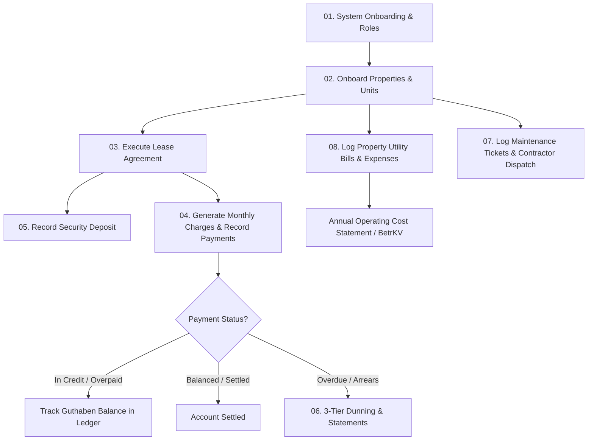

# Localea Master Operations Guide: End-to-End Property & Rental Management

Welcome to the comprehensive operational documentation for **Localea Rental Management**. This library provides complete, step-by-step technical and operational workflows for managing residential and commercial real estate portfolios, condominium associations (WEG), leases, financial ledgers, utility billing, maintenance, and communications.

---

## Guide Index

| Guide | Scope & Key Operations |
| :--- | :--- |
| [**01. User Onboarding & Authentication**](./01-user-onboarding-and-authentication.md) | Multi-tenant setup, system roles (Admin, Verwalter, Buchhaltung, Beirat, Mieter, Eigentümer, Handwerker), RBAC enforcement, self-service tenant portals, and API/MCP personal access tokens. |
| [**02. Properties, Buildings & Units Onboarding**](./02-properties-buildings-and-units-onboarding.md) | Hierarchical portfolio structure (Estate → Building → Unit), rental vs. HOA (WEG) management, 2025 Property Tax (Grundsteuer) reform data, meter setup, and CSV batch ingestion. |
| [**03. Leasing & Tenancy Management**](./03-leasing-and-tenancy-management.md) | Lease contracts, cold rent vs. gross rent components (Nebenkosten, Heizkosten, Stellplatz), stepped rent (Staffelmiete), CPI-indexed rent (Indexmiete), and tenant matching. |
| [**04. Finances, Credit/Debit Ledger & Payments**](./04-finances-credit-debit-ledger-and-payments.md) | Complete double-entry tenant ledgers, automated monthly charge generation, payment recording, overpayment (Guthaben) tracking, CAMT.053 XML bank import, SEPA direct debits, and DATEV export. |
| [**05. Security Deposits Management**](./05-security-deposits-management.md) | Deposit types (Cash, Guarantee, Pledged, Fiduciary Account), compound annual interest calculation, receipt logging, and return/withholding protocols. |
| [**06. Communication, Dunning & Statements**](./06-communication-dunning-and-statements.md) | 3-tier automated dunning process, email dunning via SMTP, BetrKV & HeizkostenV service charge statements, commercial area-day statements, and template mail merge. |
| [**07. Ticketing, Maintenance & Offline Sync**](./07-ticketing-maintenance-and-offline-sync.md) | Instandhaltung workflows, contractor management, work orders, recurring maintenance inspection contracts, and progressive offline field syncing. |
| [**08. Property Utility Bills & Cost Allocation**](./08-property-utility-bills-and-cost-allocation.md) | Property-level utility logging (Water, Heating, Waste, Insurance), apportionable (umlagefähig) vs non-apportionable costs, and 5 distribution keys (Area, Units, Persons, MEA, Consumption). |
| [**09. Branding & Design System**](./09-branding-and-design-system.md) | Localea 2K crest logo, emerald forest green and warm gold branding, video showcase sequence, typography, and tabular numeral precision. |

---

## Operational Flow: From Day One to Full Automation

Each guide in this directory provides real code references, schema definitions, mathematical calculation methods, and user interface workflows designed for property managers, accountants, and system administrators.
